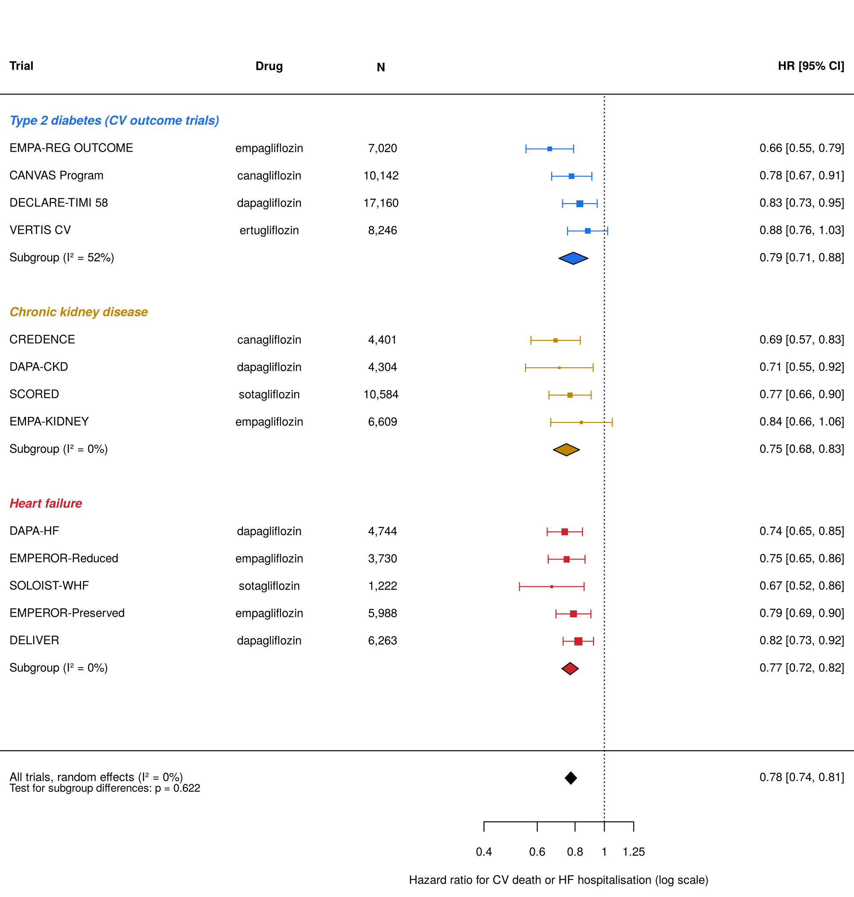
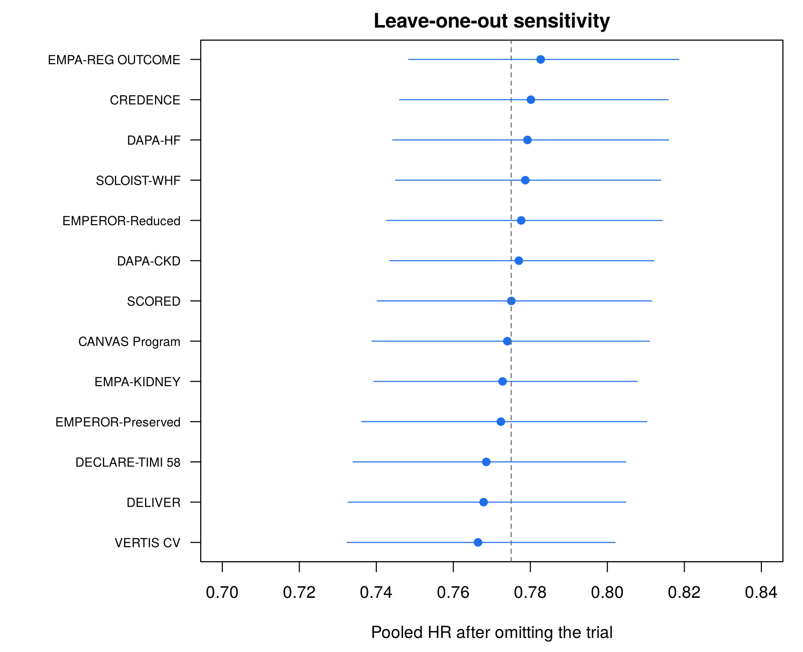
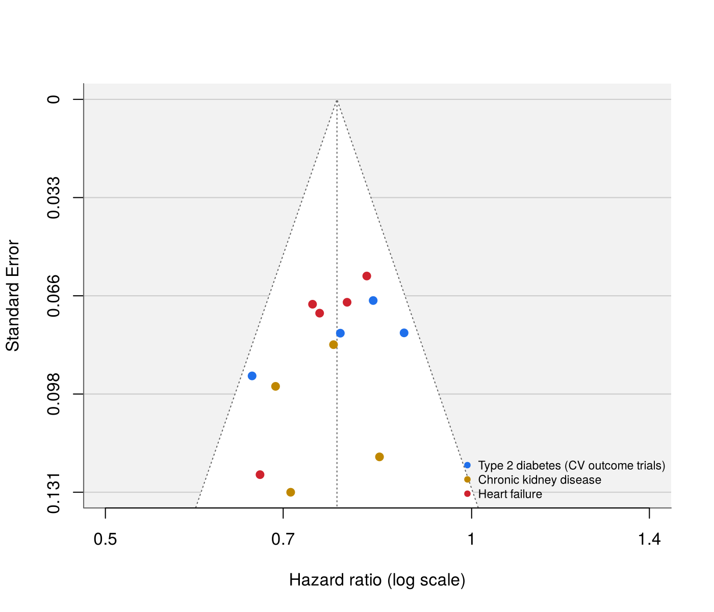

# SGLT2 Inhibitors and Heart Failure Outcomes: A Meta-Analysis of 13 Outcome Trials


A reproducible, trial-level meta-analysis in R. It asks whether the effect of sodium-glucose cotransporter 2 (SGLT2)
inhibitors on **cardiovascular death or hospitalisation for heart failure** is consistent across the three
populations in which they were tested:

* type 2 diabetes,
* chronic kidney disease (CKD),
* established heart failure.

Every hazard ratio was transcribed from the primary trial publication or its pre-specified secondary report. Each row
carries its PMID/DOI in [`data/trials.csv`](data/trials.csv) so the data can be audited line by line.

## Clinical question

> Across large placebo-controlled outcome trials, how much do SGLT2 inhibitors reduce the risk of cardiovascular death
> or heart-failure hospitalisation, and does the benefit depend on whether patients were enrolled for diabetes, kidney
> disease or heart failure?

## Included trials (k = 13, 90,413 participants)

| Population | Trials |
|---|---|
| Type 2 diabetes (CV outcome trials) | EMPA-REG OUTCOME, CANVAS Program, DECLARE-TIMI 58, VERTIS CV |
| Chronic kidney disease | CREDENCE, DAPA-CKD, SCORED, EMPA-KIDNEY |
| Heart failure | DAPA-HF, EMPEROR-Reduced, SOLOIST-WHF, EMPEROR-Preserved, DELIVER |

Inclusion: randomised, placebo-controlled, event-driven trials of an SGLT2 inhibitor reporting a hazard ratio for CV
death or HF hospitalisation, published in *NEJM* from 2015 to 2023.

## Methods

* **Effect measure:** log hazard ratio. The SE is recovered from the reported CI at its stated confidence level, which
  handles VERTIS CV's 95.8% interval correctly.
* **Model:** random-effects (REML τ²), with fixed-effect and Hartung–Knapp–Sidik–Jonkman sensitivity analyses.
* **Heterogeneity:** I², τ², Cochran's Q, and a 95% prediction interval.
* **Subgroups:** by trial population, tested with meta-regression.
* **Outcome-definition sensitivity:** three trials used broader composites, so they are excluded in a sensitivity
  analysis:
  * DAPA-HF and DELIVER also count urgent HF visits;
  * SOLOIST-WHF counts total (recurrent) events.
* **Drug sensitivity:** excluding sotagliflozin, a dual SGLT1/2 inhibitor.
* **Robustness:** leave-one-out analysis, and a funnel plot with an Egger-type test (low power at k = 13).

## Results

**Pooled HR 0.78 (95% CI 0.74–0.81)**, corresponding to a 22% relative reduction in CV death or HF hospitalisation.
Between-trial heterogeneity was negligible (I² = 0%, Q = 12.1, p = 0.44).

| Population | Trials | Participants | Pooled HR (95% CI) |
|---|---|---|---|
| Type 2 diabetes (CV outcome trials) | 4 | 42,568 | 0.79 (0.71–0.88) |
| Chronic kidney disease | 4 | 25,898 | 0.75 (0.68–0.83) |
| Heart failure | 5 | 21,947 | 0.77 (0.72–0.82) |

Test for subgroup differences: p = 0.62.

<p align="center"></p>

| Sensitivity analysis | Trials | Pooled HR (95% CI) |
|---|---|---|
| Fixed effect | 13 | 0.78 (0.74–0.81) |
| Hartung–Knapp–Sidik–Jonkman | 13 | 0.78 (0.74–0.81) |
| Strict definition only (first CV death or HHF) | 10 | 0.78 (0.74–0.82) |
| Excluding sotagliflozin | 11 | 0.78 (0.74–0.82) |

No single trial moves the pooled estimate outside 0.77–0.78 ([leave-one-out](figures/leave_one_out.png)).
Full output: [`results/results.md`](results/results.md).

<p align="center">
  
  
</p>

### Interpretation

The benefit of SGLT2 inhibition on heart-failure outcomes is **remarkably consistent**. It is about the same whether
patients were enrolled for diabetes, CKD or heart failure, across four different molecules, and under strict or broad
outcome definitions. This supports the view that the cardio-renal benefit is a **class effect largely independent of
glucose lowering**, as reflected in current guidelines recommending SGLT2 inhibitors across all three indications.

The only signal of heterogeneity is within the diabetes trials (I² = 52%). That is plausibly explained by baseline
risk: EMPA-REG enrolled only patients with established ASCVD, whereas most DECLARE participants had risk factors
alone.

## Limitations

* This is a **trial-level** (aggregate) meta-analysis. Patient-level effect modifiers such as ejection fraction and
  eGFR cannot be examined.
* Outcome definitions differ slightly between trials. This is addressed with a sensitivity analysis, not eliminated.
* The forest plot shows symmetric 95% CIs recomputed on the log scale, which can differ from published intervals in
  the second decimal place.
* Not a systematic review: trials were identified from known landmark publications, not from a registered
  search (PROSPERO) and PRISMA flow.
* For research and education. **Not clinical guidance.**

## Reproduce

```bash
git clone https://github.com/alirezajavan-sys/sglt2-inhibitor-meta-analysis.git
cd sglt2-inhibitor-meta-analysis
Rscript -e 'install.packages(c("metafor", "knitr", "testthat"))'
Rscript analysis.R
Rscript -e 'testthat::test_dir("tests/testthat")'
```

The tests check the extracted data for transcription errors (HR vs CI midpoint), DOI provenance, CI-level handling,
and agreement of a hand-written inverse-variance pool with metafor.

## Repository structure

```
├── data/trials.csv          # one row per trial: HR, CI, CI level, definition, PMID, DOI, source note
├── R/functions.R            # SE-from-CI, data loading, formatting (unit-tested)
├── analysis.R               # meta-analysis, subgroups, sensitivity, figures
├── results/                 # results.md + CSV tables
├── figures/                 # forest, funnel and leave-one-out plots
└── tests/testthat/          # data-integrity and method tests
```

## References

Primary trial publications (*N Engl J Med*). DOIs are in `data/trials.csv`.

* Zinman B, et al. (EMPA-REG OUTCOME) 2015;373:2117–28
* Neal B, et al. (CANVAS) 2017;377:644–57
* Wiviott SD, et al. (DECLARE-TIMI 58) 2019;380:347–57
* Cannon CP, et al. (VERTIS CV) 2020;383:1425–35
* Perkovic V, et al. (CREDENCE) 2019;380:2295–306
* Heerspink HJL, et al. (DAPA-CKD) 2020;383:1436–46
* Bhatt DL, et al. (SCORED) 2021;384:129–39
* EMPA-KIDNEY Collaborative Group. 2023;388:117–27
* McMurray JJV, et al. (DAPA-HF) 2019;381:1995–2008
* Packer M, et al. (EMPEROR-Reduced) 2020;383:1413–24
* Bhatt DL, et al. (SOLOIST-WHF) 2021;384:117–28
* Anker SD, et al. (EMPEROR-Preserved) 2021;385:1451–61
* Solomon SD, et al. (DELIVER) 2022;387:1089–98

Secondary reports for HF outcomes:

* Fitchett D, et al. *Eur Heart J* 2016 (EMPA-REG)
* Rådholm K, et al. *Circulation* 2018;138:458–68 (CANVAS)

Methods:

* Viechtbauer W. Conducting meta-analyses in R with the metafor package. *J Stat Softw.* 2010;36(3):1–48.

## Author

**Alireza Javan**. [GitHub profile](https://github.com/alirezajavan-sys)
